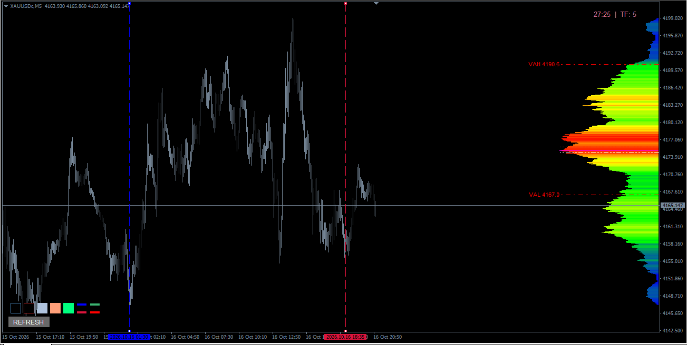
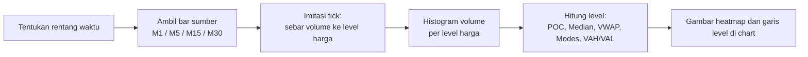

# VP-Range — Volume Profile pada Rentang Waktu untuk MT4




> Indikator MetaTrader 4 yang menggambar **Volume Profile** pada rentang waktu pilihan (dua garis vertikal, N candle terakhir, atau N menit), lengkap dengan heatmap warna ala RVP, level POC / Median / VWAP, dan **Value Area (VAH/VAL)**.

---

## Ringkasan

**VP-Range v6.3** (`VP-Range-v6_3.mq4`) adalah indikator *chart-window* yang menghitung dan menggambar *volume profile* — distribusi volume per level harga — untuk rentang waktu tertentu di chart. MT4 tidak menyimpan data tick, jadi volume setiap bar pada timeframe sumber (default M1) disebar ke level-level harga dengan meniru pergerakan tick di dalam bar.

Hasilnya berupa histogram horizontal berwarna heatmap (biru → hijau → kuning → merah) yang menunjukkan di harga mana volume paling banyak terjadi, dilengkapi garis **POC**, **Median**, **VWAP**, serta **VAH** dan **VAL**.

Proyek ini adalah turunan dari **VP-Range v6.0 karya FXcoder**. Tambahan yang dibuat oleh Denta Arvihaknata:

- **v6.1** — Color mode *Heatmap* (sama seperti Rectangle Volume Profile v6.0) menjadi warna default; mode rentang baru *Lookback candles*; mode *Between lines* diberi label *Double VLine* dan garis batasnya disembunyikan (bukan dihapus) saat pindah mode; bar style default menjadi *Filled bar*.
- **v6.2** — Value Area (VAH dan VAL) dengan garis dan label harga.
- **v6.3** — Garis VAH/VAL digambar langsung di area histogram (selebar histogram), bukan sepanjang rentang di chart.

---

## Fitur Utama

- **Empat mode rentang** — *Double VLine* (dua garis yang bisa digeser), *Last minutes*, *Minutes to line*, dan *Lookback candles*.
- **Sumber data fleksibel** — bar M1, M5, M15, atau M30; volume tick atau volume riil.
- **Imitasi tick** — volume tiap bar disebar mengikuti jalur harga di dalam bar (open → low → high → close untuk bullish, open → high → low → close untuk bearish).
- **Resolusi harga otomatis** — langkah level harga mengikuti simbol (skala ×100 untuk `XAUUSD`, ×1 untuk simbol lain).
- **Dua mode warna** — *Heatmap* (gaya RVP) atau *Gradient* (dua warna pilihan).
- **Lima gaya bar dan enam posisi histogram** — Line, Empty bar, Filled bar, Outline, Color; di tepi window, di luar, atau di dalam rentang.
- **Level statistik** — POC (Max), Median, VWAP, Modes (puncak volume lokal), dan garis horizontal Mode level.
- **Value Area** — persentase dapat diatur (default 70%), memakai metode standar Market Profile/CME, lengkap dengan label harga VAH/VAL.
- **Pembaruan otomatis** — saat garis digeser, chart di-scroll atau di-zoom, warna background berubah, atau ada tick baru (untuk rentang yang mencakup candle berjalan). Bila histori belum siap, dicoba ulang tiap 3 detik.
- **Garis horizon data** — menandai awal data yang tersedia pada timeframe sumber.
- **Multi-instance** — beberapa salinan di satu chart dibedakan lewat parameter `Id`.
- **Pembersihan rapi** — semua objek histogram dihapus saat indikator dilepas; garis From/To dipertahankan saat ganti timeframe atau parameter.
- **Tanpa DLL** dan tanpa fungsi trading.

---

## Cara Kerja (Konsep Umum)



### 1. Menentukan rentang

| Mode | Rentang yang dipakai |
|---|---|
| **Double VLine** (default) | Area di antara dua garis vertikal yang bisa digeser. Bila garis belum ada, dibuat otomatis di sepertiga dan dua-pertiga lebar chart yang terlihat. Bila posisinya tertukar, urutannya dibetulkan otomatis. |
| **Last minutes** | `RangeMinutes` menit terakhir (dihitung dari bar M1, tidak bergantung pada timeframe chart). Garis batas disembunyikan. |
| **Minutes to line** | `RangeMinutes` menit ke belakang dari garis kanan yang bisa digeser. Garis kiri dihitung otomatis dan tidak bisa dipilih. Jarak dihitung dalam satuan bar timeframe chart (dibulatkan ke bawah). |
| **Lookback candles** | `LookbackCandles` candle terakhir pada timeframe chart aktif, termasuk candle yang sedang berjalan. Garis batas disembunyikan. |

Pada mode *Last minutes* dan *Lookback candles*, posisi garis From/To tidak dihapus, hanya disembunyikan, sehingga posisinya tetap ada saat kamu kembali ke mode *Double VLine*.

### 2. Mengambil data sumber

Bar pada timeframe sumber (`DataSource`) untuk seluruh rentang diambil dengan `CopyRates`. Volume yang dipakai adalah **tick volume** (default) atau **volume riil** (`VolumeType`).

### 3. Menyebar volume ke level harga

Harga OHLC tiap bar dibulatkan ke grid harga, lalu volume bar disebar ke level-level yang dilalui jalur tick imitasi:

- **Bar bullish** (`close ≥ open`): `open → low → high → close`
- **Bar bearish**: `open → high → low → close`

Volume bar dibagi rata ke setiap langkah level yang dilalui jalur tersebut, sehingga level yang terlewati berulang kali (misalnya area ekor candle) menerima porsi lebih besar.

**Langkah harga histogram** ditentukan di `OnInit`:

| Simbol | Skala | Langkah harga |
|---|---|---|
| Mengandung `XAUUSD` | ×100 | `Point × 100` (mis. Point 0.01 → langkah 1.00) |
| Lainnya | ×1 | `Point` |

### 4. Menghitung level

| Level | Cara hitung |
|---|---|
| **POC / Max** | Baris harga dengan volume terbesar. |
| **Median** | Baris tempat volume kumulatif pertama kali mencapai setengah total volume. |
| **VWAP** | Rata-rata harga tertimbang volume dari seluruh baris histogram. |
| **Modes** | Puncak volume lokal: baris yang volumenya terbesar dalam jendela ±`ModeStep` baris (nilai `ModeStep` dibagi skala titik simbol). |
| **VAH / VAL** | Mulai dari POC, area diperluas ke atas atau ke bawah dengan membandingkan total **2 baris di atas** vs **2 baris di bawah** (metode standar Market Profile/CME), sisi yang lebih besar ditambahkan, sampai mencapai `VaPercent`% dari total volume. VAH = batas atas, VAL = batas bawah. |

### 5. Menggambar

- Setiap baris harga digambar sebagai satu objek chart. Panjang bar sebanding dengan volume baris tersebut.
- Pada color mode **Heatmap**, warna ditentukan oleh `volume baris / volume maksimum`: 0,00 biru → 0,33 hijau → 0,66 kuning → 1,00 merah.
- Pada color mode **Gradient**, warna dicampur linear dari `HgColor` (volume rendah) ke `HgColor2` (volume tinggi).
- Garis POC, Median, VWAP, VAH, dan VAL digambar selebar histogram.

### 6. Pembaruan

Perhitungan ulang dipicu oleh: garis From/To yang digeser, perubahan tampilan chart (scroll, zoom, warna background), timer, dan tick baru bila rentang mencakup candle berjalan. Jeda minimal antar-pembaruan adalah 500 ms. Jika data sumber belum tersedia, pembaruan diulang tiap 3 detik.

### Catatan dan batasan

- Histogram dibangun dari **imitasi tick**, bukan data tick asli. Semakin kecil timeframe sumber, semakin halus hasilnya (M1 paling detail).
- Volume yang dipakai secara default adalah tick volume. Volume riil hanya berguna bila broker menyediakannya; bila tidak, nilainya nol.
- Karena satu baris harga = satu objek chart, rentang yang sangat lebar pada simbol dengan `Point` kecil bisa menghasilkan banyak objek dan terasa berat. Gaya *Empty bar* menggambar 4 objek per baris.
- Histori timeframe sumber harus mencakup seluruh rentang. Garis horizon data menunjukkan data paling awal yang tersedia.

---

## Kebutuhan Sistem

- **MetaTrader 4**, build 600 atau lebih baru.
- **Data histori timeframe sumber** (M1 secara default) yang mencakup rentang yang dipilih. Cek di *Tools → History Center* dan *Tools → Options → Charts → Max bars in history / chart*.
- Tick volume (tersedia di semua broker), atau volume riil bila broker menyediakannya.
- Tidak memerlukan DLL, WebRequest, ataupun izin trading.

---

## Instalasi

1. Unduh file `VP-Range-v6_3.mq4` dari repositori ini.
2. Di MT4, buka **File → Open Data Folder**, lalu masuk ke `MQL4\Indicators`.
3. Salin file `.mq4` ke folder tersebut.
4. Buka **MetaEditor** (tekan `F4` di MT4), buka file tadi, lalu tekan **Compile** (`F7`). Pastikan tidak ada error.
5. Kembali ke MT4, klik kanan panel **Navigator → Refresh** (atau restart MT4). Indikator muncul di bagian *Indicators* dengan nama **VP-Range-v6_3**.

---

## Cara Pakai

1. Seret **VP-Range-v6_3** dari Navigator ke chart.
2. Dengan pengaturan default (mode *Double VLine*), dua garis vertikal muncul di chart: **biru** (batas kiri) dan **merah** (batas kanan). Histogram muncul di tepi kanan jendela chart.
3. **Geser kedua garis** untuk mengubah rentang. Histogram diperbarui otomatis.
4. Untuk mengganti mode rentang, buka properti indikator (`Ctrl+I`) lalu ubah `RangeMode`:
   - *Lookback candles* → atur `LookbackCandles`
   - *Last minutes* atau *Minutes to line* → atur `RangeMinutes`
5. Baca profil:
   - Warna **merah/kuning** = area volume tinggi, **biru** = volume rendah.
   - Garis **magenta** = POC, **peru** = Median, **putih** = VWAP.
   - Garis **merah putus-titik** berlabel `VAH` dan `VAL` = batas Value Area.
6. Ubah posisi, gaya bar, dan warna lewat grup parameter *Histogram* dan *Levels*.

**Perilaku saat ganti kondisi:**

- Ganti timeframe atau ubah parameter → histogram dibangun ulang; posisi garis From/To dipertahankan.
- Indikator dilepas dari chart → semua objek histogram dan garis From/To ikut dihapus.
- Menjalankan lebih dari satu salinan di chart yang sama → beri nilai `Id` yang berbeda untuk tiap salinan.

**Jika histogram tidak muncul:**

- Tunggu beberapa detik; bila histori belum termuat, indikator mencoba lagi tiap 3 detik.
- Pastikan data timeframe sumber tersedia untuk rentang yang dipilih (lihat garis horizon data berwarna merah titik-titik).
- Pada mode *Double VLine*, pastikan kedua garis berada di area yang berisi data.
- Pastikan warna histogram tidak diset ke *None*.

---

## Konfigurasi

### Memilih mode rentang

| Kebutuhan | Setelan |
|---|---|
| Profil untuk area yang kamu tandai sendiri | `RangeMode = Double VLine`, geser garis |
| Profil dari N candle terakhir, ikut bergerak | `RangeMode = Lookback candles`, atur `LookbackCandles` |
| Profil dari N menit terakhir, apa pun timeframe chart | `RangeMode = Last minutes`, atur `RangeMinutes` |
| Profil N menit sebelum titik tertentu | `RangeMode = Minutes to line`, atur `RangeMinutes`, geser garis kanan |

### Memilih sumber data

| Setelan | Efek |
|---|---|
| `DataSource = M1` (default) | Imitasi tick paling halus; butuh histori M1 yang cukup. |
| `DataSource = M5 / M15 / M30` | Lebih ringan dan histori lebih panjang tersedia, tetapi distribusi volume lebih kasar. |
| `VolumeType = Real volume` | Hanya jika broker menyediakan volume riil. |

### Menambah simbol dengan skala titik berbeda

Skala titik ditentukan di fungsi `OnInit`. Secara default hanya simbol yang mengandung `XAUUSD` memakai skala ×100. Untuk menambah simbol lain, ubah kondisi berikut lalu compile ulang:

```mql4
if(StringFind(pair, "XAUUSD") != -1 || StringFind(pair, "EURUSD") != -1)
   HgPointScale = POINT_SCALE_100;
else
   HgPointScale = POINT_SCALE_1;
```

Pilihan skala yang tersedia: `POINT_SCALE_1`, `POINT_SCALE_10`, `POINT_SCALE_100`. Skala yang lebih besar membuat langkah harga lebih lebar, sehingga jumlah baris dan objek berkurang.

### Value Area

- Atur persentase lewat `VaPercent` (default 70).
- Nonaktifkan VAH atau VAL dengan mengatur `VahColor` atau `ValColor` ke *None*.
- Sembunyikan label harga dengan `ShowVaLabels = false`.

### Modes dan Mode level

Keduanya mati secara default (`ModeColor` dan `ModeLevelColor` = *None*). Aktifkan dengan memilih warna:

- `ModeColor` — menggambar garis di setiap puncak volume lokal pada histogram.
- `ModeLevelColor` — menggambar garis horizontal sepanjang chart di harga puncak tersebut.
- `ModeStep` mengatur kepekaan: makin besar, makin sedikit puncak yang terdeteksi.

### Performa

- Perkecil rentang (atau pakai skala titik lebih besar) bila chart terasa berat.
- Hindari gaya *Empty bar* pada rentang lebar karena memakai 4 objek per baris.
- Pakai `DataSource` yang lebih besar untuk rentang panjang bila histori M1 terbatas.

---

## Parameter Input

### Calculation

| Parameter | Default | Keterangan |
|---|---|---|
| `RangeMode` | `Double VLine` | Mode rentang: `Double VLine (between lines)`, `Last minutes`, `Minutes to line`, `Lookback candles` |
| `LookbackCandles` | `500` | Jumlah candle ke belakang (mode *Lookback candles*); dibatasi antara 1 dan total bar |
| `RangeMinutes` | `1440` | Jumlah menit (mode *Last minutes* dan *Minutes to line*) |
| `ModeStep` | `100` | Jendela pencarian puncak lokal dalam points; dibagi skala titik simbol |
| `VolumeType` | `Tick volume` | `Tick volume` atau `Real volume` |
| `DataSource` | `M1 bars` | Timeframe sumber: `M1`, `M5`, `M15`, `M30` |

### Histogram

| Parameter | Default | Keterangan |
|---|---|---|
| `HgBarStyle` | `Filled bar` | `Line`, `Empty bar`, `Filled bar`, `Outline`, `Color` |
| `HgPosition` | `Window right` | `Window left`, `Window right`, `Left outside`, `Right outside`, `Left inside`, `Right inside` |
| `HgColorMode` | `Heatmap` | `Heatmap` (biru-hijau-kuning-merah) atau `Gradient` (Color 1 → Color 2) |
| `HgColor` | `C'128,160,128'` | Color 1 — volume rendah (mode Gradient) |
| `HgColor2` | `Maroon` | Color 2 — volume tinggi (mode Gradient) |
| `HgLineWidth` | `1` | Ketebalan garis bar |

**Posisi histogram:**

| Posisi | Letak |
|---|---|
| Window left / Window right | Menempel di tepi kiri / kanan jendela chart |
| Left outside / Right outside | Di luar batas kiri / kanan rentang |
| Left inside / Right inside | Tumbuh dari batas kiri / kanan ke dalam rentang; bar terpanjang selebar rentang |

### Levels

| Parameter | Default | Keterangan |
|---|---|---|
| `ModeColor` | `clrNONE` | Warna garis Modes (None = nonaktif) |
| `MaxColor` | `clrMagenta` | Warna garis Maximum / POC |
| `MedianColor` | `clrPeru` | Warna garis Median |
| `VwapColor` | `clrWhite` | Warna garis VWAP |
| `ModeLineWidth` | `3` | Ketebalan garis POC, Modes, Median, dan VWAP |
| `StatLineStyle` | `STYLE_DASHDOTDOT` | Gaya garis Median dan VWAP |
| `ModeLevelColor` | `clrNONE` | Warna garis horizontal Mode level (None = nonaktif) |
| `ModeLevelStyle` | `STYLE_SOLID` | Gaya garis Mode level |

### Value Area

| Parameter | Default | Keterangan |
|---|---|---|
| `VaPercent` | `70` | Value Area dalam % dari total volume |
| `VahColor` | `clrRed` | Warna VAH (None = nonaktif) |
| `ValColor` | `clrRed` | Warna VAL (None = nonaktif) |
| `VaLineStyle` | `STYLE_DASHDOT` | Gaya garis VAH dan VAL |
| `VaLineWidth` | `2` | Ketebalan garis VAH dan VAL (hanya berlaku untuk gaya solid) |
| `ShowVaLabels` | `true` | Tampilkan label harga VAH/VAL |

### Service

| Parameter | Default | Keterangan |
|---|---|---|
| `Id` | `+vpr` | Identifier objek; ubah bila memakai lebih dari satu salinan di satu chart |

### Parameter internal

Nilai berikut tidak muncul di dialog properti. Ubah langsung di kode sumber bila perlu:

| Variabel | Nilai | Keterangan |
|---|---|---|
| `ShowHorizon` | `true` | Tampilkan garis horizon data |
| `Zoom` | `0` | Skala lebar histogram (0 = otomatis) |
| `HgWidthPercent` | `15` | Lebar histogram dalam % dari lebar chart (posisi window dan outside) |
| `WaitMilliseconds` | `500` | Jeda minimal antar-pembaruan (ms) |
| `ModeLevelWidth` | `3` | Ketebalan garis Mode level |
| `TimeFromColor` / `TimeFromStyle` | `Blue` / `STYLE_DASH` | Garis batas kiri |
| `TimeToColor` / `TimeToStyle` | `Red` / `STYLE_DASH` | Garis batas kanan |

---

## Tampilan

<!--
Tambahkan screenshot di sini, contoh:


-->

| Elemen | Bentuk | Warna default | Arti |
|---|---|---|---|
| Histogram | Bar horizontal per level harga | Heatmap: biru → hijau → kuning → merah | Volume per level harga; merah = volume tertinggi |
| POC / Max | Garis selebar histogram | Magenta | Level dengan volume terbesar |
| Median | Garis putus titik-titik | Peru | Titik tengah volume kumulatif |
| VWAP | Garis putus titik-titik | Putih | Harga rata-rata tertimbang volume |
| VAH / VAL | Garis putus-titik selebar histogram, berlabel harga | Merah | Batas atas dan bawah Value Area |
| Modes | Garis selebar histogram | Nonaktif (None) | Puncak volume lokal |
| Mode level | Garis horizontal sepanjang chart | Nonaktif (None) | Harga puncak volume lokal |
| Garis From / To | Garis vertikal putus-putus | Biru / Merah | Batas rentang (mode Double VLine dan Minutes to line) |
| Garis horizon data | Garis vertikal titik-titik | Merah | Awal data yang tersedia pada timeframe sumber |

Label VAH/VAL menampilkan teks seperti `VAH 2345.00` dan `VAL 2310.00` (angka hanya ilustrasi), ditempatkan di ujung luar garis dengan teks mengarah menjauhi histogram.

---

## Disclaimer

Indikator ini adalah alat bantu analisis visual dan **bukan** saran investasi, rekomendasi beli/jual, ataupun jaminan hasil. Trading forex, emas, dan instrumen margin lainnya berisiko tinggi dan dapat menyebabkan kerugian melebihi modal. Volume profile yang ditampilkan dibangun dari imitasi tick berdasarkan data bar broker, sehingga dapat berbeda antar broker dan tidak sama dengan profil dari data tick atau volume bursa yang sebenarnya.

Software disediakan **"apa adanya" (as is)** tanpa garansi apa pun. Pengguna bertanggung jawab penuh atas keputusan trading masing-masing. Uji terlebih dahulu di akun demo sebelum dipakai di akun riil.

---

## Lisensi

Proyek ini adalah karya turunan dari **VP-Range v6.0** oleh **FXcoder** (<http://fxcoder.blogspot.com>), yang didistribusikan dengan ketentuan lisensi **BSD 3-Clause** seperti tercantum pada header file sumber. Pemberitahuan hak cipta, daftar ketentuan, dan disclaimer asli wajib tetap disertakan pada setiap redistribusi.

Modifikasi pada v6.1–v6.3 — Copyright © 2023 **Denta Arvihaknata**.

```
Copyright (c) FXcoder. All rights reserved.

Redistribution and use in source and binary forms, with or without modification, are permitted provided that the
following conditions are met:

    * Redistributions of source code must retain the above copyright notice, this list of conditions and the following
      disclaimer.

    * Redistributions in binary form must reproduce the above copyright notice, this list of conditions and the
      following disclaimer in the documentation and/or other materials provided with the distribution.

    * Neither the name of the FXcoder nor the names of its contributors may be used to endorse or promote products
      derived from this software without specific prior written permission.

This software is provided by the copyright holders and contributors "as is" and any express or implied warranties,
including, but not limited to, the implied warranties of merchantability and fitness for a particular purpose are
disclaimed. In no event shall the copyright holder or contributors be liable for any direct, indirect, incidental,
special, exemplary, or consequential damages (including, but not limited to, procurement of substitute goods or
services; loss of use, data, or profits; or business interruption) however caused and on any theory of liability,
whether in contract, strict liability, or tort (including negligence or otherwise) arising in any way out of the use of
this software, even if advised of the possibility of such damage.
```
